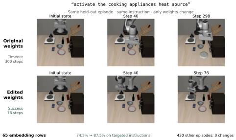

# Can LLMs Debug Robots by Editing Their Weights?

[Paper](https://arxiv.org/abs/2611.09376) · [中文说明](README_zh.md) · [Reproduction guide](docs/REPRODUCING.md) · [Sparse edit](edits/pi05-language-c) · [Evidence](evidence) · [16 experiment transcripts](transcripts)

**GPT-6 Astra repairs lexical instruction failures in a pretrained robot policy by editing 65 token-embedding rows, using weight inspection and budgeted simulator feedback, without gradient updates or new demonstrations.**

Jusheng Zhang¹ · Keze Wang² · Liang Lin²  
¹ Stanford University · ² X-Era AI



## Results

The best π₀.₅ edit raises success from **86.3% to 92.0%** on 765 held-out
LIBERO-Plus paraphrases: **48 repairs and 4 regressions**, exact paired
*p* = 1.31 × 10⁻¹⁰. Among the 335 instructions containing edited tokens,
success rises from **74.3% to 87.5%**. The other **430 episodes have zero
binary outcome changes**; this is not a claim that their trajectories are identical.

| Independent editing session | Original | Edited | Change |
| --- | ---: | ---: | ---: |
| A | 660 / 765 | 684 / 765 | +3.1 pp |
| B | 660 / 765 | 673 / 765 | +1.7 pp |
| C | 660 / 765 | 704 / 765 | +5.8 pp |

All three sessions improve on the same held-out population. Matched random-direction
edits do not help. Full replacement using the editor's lexicon explains much of the
gain but creates more regressions; its direct comparison with the editor is not
significant at 0.05. The paper reports both error-accounting conventions.

Across 13 further editing sessions, the editor declines 12 candidates; the sole
retained edit has no significant held-out gain. Separately, instruction metadata
reduces FastWAM success from 70.0% to 48.6%, while the evaluated VLA's aggregate
rate is unchanged. These results support precise lexical repair, not general
acquisition of missing robot capabilities.

## Reproduce the numbers without a GPU

```bash
git clone https://github.com/jushengzhang/robot-weight-debugging.git
cd robot-weight-debugging
python3 evidence/audit_new_results.py
```

This standard-library script recomputes the primary paired results, token-hit
partitions, controls, metadata sensitivity, and archived PRO outcomes from
released episode records. For the extended seed, locality, and norm/direction
evidence:

```bash
python3 -m pip install 'numpy>=1.26,<3'
python3 evidence/extended/audit_extended.py
```

## Apply the evaluated 65-row edit

The release contains the **actual evaluated original and edited rows**, plus the
token IDs and interpolation recipe. The application script verifies the original
rows against a compatible flat `pi05_libero` checkpoint and leaves that checkpoint
unchanged.

```bash
python3 -m pip install 'numpy>=1.26,<3'
python3 edits/pi05-language-c/apply_sparse_rows.py \
  /path/to/pi05_libero_flat.safetensors --dry-run
python3 edits/pi05-language-c/apply_sparse_rows.py \
  /path/to/pi05_libero_flat.safetensors --output /path/to/embed_override.npy
```

The full replacement tensor is approximately 2.11 GB. See the
[edit instructions](edits/pi05-language-c/README.md) and
[reproduction guide](docs/REPRODUCING.md) for the evaluated base model and backend.
The original model and simulator assets must be obtained from their upstream projects.

## Repository contents

| Directory | Contents |
| --- | --- |
| `experiments/harness/` | LLM loop, persistent CPU Python kernel, feedback budget, and final-turn cleanup |
| `experiments/domains/` | Task specifications, allowed operations, forward tools, and held-out evaluators |
| `experiments/backends/` | FastWAM and π₀.₅ simulator servers, clients, and weight override/restore logic |
| `scripts/configure_workspace.py` | Copies the historical sources into a configured local layout; does not launch experiments |
| `edits/pi05-language-c/` | Evaluated 65-row payload, tokenizer recipe, and application script |
| `evidence/` | Episode records, statistical audits, controls, and extended evidence |
| `transcripts/` | All 16 robot editing sessions and the session manifest |
| `paper/` | Paper PDF and arXiv source bundle |
| `assets/` | Paper figures and selected actual simulator videos |

The `experiments/` sources preserve the code used in the study, including the
historical machine layout. Use the configuration tool before running them on
another machine; the release is not a containerized simulator installation.
Dependencies and checkpoint conversion are documented in the backend READMEs.

## Artifact interpretation

For the first FastWAM wave, an execution bug left archived edits on disk even
though the editor's final message requested withdrawal. Their presence is **not**
evidence that the editor retained them. The driver includes the subsequent
final-turn cleanup fix, and the paper distinguishes archived candidates from
retained edits. The suffix follow-up and uncertain LIBERO-PRO results are included
in the evidence and paper.

This release corresponds to [arXiv:2611.09376v1](https://arxiv.org/abs/2611.09376v1).
It contains no RoboDojo result claim.

## Citation

```bibtex
@article{zhang2026debugrobots,
  title   = {Can LLMs Debug Robots by Editing Their Weights?},
  author  = {Zhang, Jusheng and Wang, Keze and Lin, Liang},
  journal = {arXiv preprint arXiv:2611.09376},
  year    = {2026},
  doi     = {10.48550/arXiv.2611.09376},
  url     = {https://arxiv.org/abs/2611.09376}
}
```

## License

Original project code is released under [Apache-2.0](LICENSE). Model-derived
payloads, external checkpoints, datasets, and the paper retain their applicable
terms; see [third-party notices](THIRD_PARTY_NOTICES.md).
