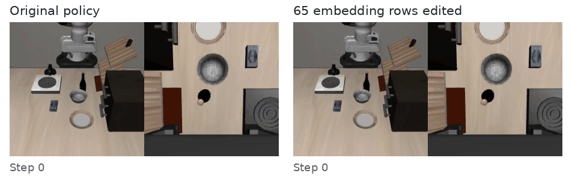

# Can LLMs Debug Robots by Editing Their Weights?

[Jusheng Zhang](https://jushengzhang.github.io/)¹ · Keze Wang² · [Liang Lin](https://scholar.google.com/citations?user=Nav8m8gAAAAJ)²<br>
¹ Stanford University · ² X-Era AI

**[Paper](https://arxiv.org/abs/2611.09376) · [First release](https://github.com/jushengzhang/robot-weight-debugging/releases/tag/v0.1.0) · [Experiment logs](transcripts) · [Reproduce](docs/REPRODUCING.md) · [中文](README_zh.md)**

> **First research release (v1).** This repository accompanies [arXiv v1](https://arxiv.org/abs/2611.09376v1). **Version 2 and real-robot experiments are in progress.** The results released here are from simulation. [Project status →](docs/PROJECT_STATUS.md)

GPT-6 Astra reads a pretrained robot policy's weights and repairs a class of instruction failures by editing **65 token-embedding rows**. The editing process uses weight inspection and budgeted simulator feedback, with **no gradient updates or new demonstrations**.



*Same instruction, scene, seed, and initial-state index; original π₀.₅ on the left, edited policy on the right.*

> “position the glass container of fermented grapes atop the storage unit for dishes and utensils”

The original times out at **300 steps**; the edited policy succeeds at **85**. This is a selected held-out example, not an estimate of average performance. The successful rollout stays on its terminal frame while the original continues. [Original video](assets/libero_goal_v1174_s7_i0_orig_fail.mp4) · [Edited video](assets/libero_goal_v1174_s7_i0_edit_succ.mp4) · [Episode and rendering provenance](assets/README.md)

## What changes after the edit?

On **765 held-out LIBERO-Plus paraphrases**, the strongest of three independent editing sessions raises π₀.₅ success from **86.3% to 92.0%**: 48 repairs and 4 regressions, exact paired *p* = 1.31 × 10⁻¹⁰.

| Scope of session C | Original | Edited |
| --- | ---: | ---: |
| Instructions containing edited tokens · 335 episodes | **74.3%** | **87.5%** |
| Other instructions · 430 episodes | 411 successes | 411 successes |

The other 430 episodes have **zero binary outcome changes**. This refers to success/failure, not identical trajectories. All three language sessions improve significantly on the same held-out population. [Full results, controls, and limits →](docs/RESULTS.md)

<details>
<summary>View the paper's result overview</summary>


</details>

## Explore the experiments

This release includes the experiment code, all **16 editing-session transcripts**, executed tool calls and their outputs, saved notes, episode-level evaluation records, and the evaluated sparse edit. Each session has a README linking its notes, final answer, and tool log.

| Question | Policy | Sessions and records |
| --- | --- | --- |
| Can a small weight edit repair unfamiliar wording? | π₀.₅ | [A](transcripts/pi_lang_a) · [B](transcripts/pi_lang_b) · [C](transcripts/pi_lang_c) — all three improve; [evaluated edit](edits/pi05-language-c) |
| Can it repair distracting instruction suffixes? | FastWAM | [First search](transcripts/fw_suffix) · [Follow-up A](transcripts/fw_suffix2_a) · [B](transcripts/fw_suffix2_b) · [C](transcripts/fw_suffix2_c) — no significant follow-up repair |
| Can it repair visual or language perturbations? | FastWAM | [Camera](transcripts/fw_camera) · [Background](transcripts/fw_background) · [Language](transcripts/fw_language) |
| Can it improve recovery from failure states? | π₀.₅ | [A](transcripts/rec_a) · [B](transcripts/rec_b) · [C](transcripts/rec_c) — no retained repair |
| Can it improve broader robustness? | π₀.₅ | [A](transcripts/pro_a) · [B](transcripts/pro_b) · [C](transcripts/pro_c) — candidates declined; target gains uncertain |

**Read the unsuccessful searches too.** The paper distinguishes a promising internal signal, a candidate left on disk, and an edit the editor decides to retain. Some cleanup operations were not executed in the archived runs; a saved candidate alone does not establish retention. [How to read the logs →](transcripts/README.md)

## Start here

**Check the numbers without a GPU.** This script uses only the Python standard library and the released episode records:

```bash
git clone https://github.com/jushengzhang/robot-weight-debugging.git
cd robot-weight-debugging
python3 evidence/audit_new_results.py
```

| If you want to… | Open |
| --- | --- |
| Inspect or apply the actual 65-row edit | [Payload, recipe, and application script](edits/pi05-language-c) |
| Recompute the primary and supplementary results | [Evidence guide](evidence/README.md) |
| Follow one complete editing session | [Language session C](transcripts/pi_lang_c) |
| Run the backend or a new editing session | [Reproduction guide](docs/REPRODUCING.md) · [Experiment sources](experiments) |
| Download the published paper and LaTeX source | [Paper artifacts](paper) · [Release downloads](https://github.com/jushengzhang/robot-weight-debugging/releases/tag/v0.1.0) |

The base models and simulator assets come from their upstream projects. The reproduction guide documents the required environments and path configuration; this first release preserves the research code and is not a containerized simulator installation.

## Relation to weight-space programming

We build on [*Sparks of Weight-Space Programming*](https://rikiyat.github.io/blog/weight-space-programming/) and its [released experiment logs](https://github.com/RikiyaT/lm_understand-logs). Here the object being edited is a pretrained robot policy, and success is tested through paired robot rollouts. The supported result is **precise lexical repair**; the unsuccessful searches help define its current limits.

## Citation

```bibtex
@article{zhang2026debugrobots,
  title   = {Can LLMs Debug Robots by Editing Their Weights?},
  author  = {Zhang, Jusheng and Wang, Keze and Lin, Liang},
  journal = {arXiv preprint arXiv:2611.09376},
  year    = {2026},
  doi     = {10.48550/arXiv.2611.09376},
  url     = {https://arxiv.org/abs/2611.09376}
}
```

## License

Original project code is released under [Apache-2.0](LICENSE). Model-derived payloads, external checkpoints, datasets, and the paper retain their applicable terms; see [third-party notices](THIRD_PARTY_NOTICES.md).
