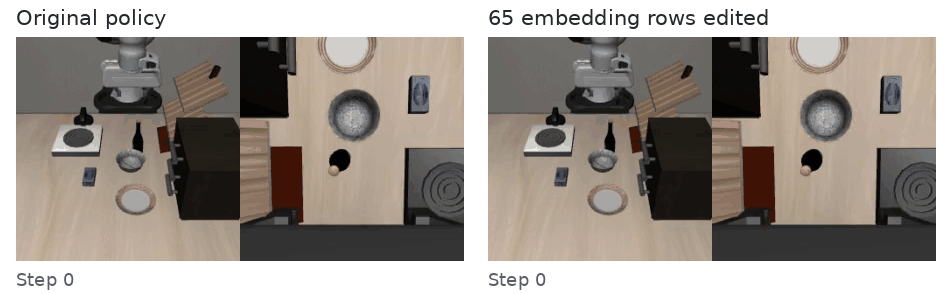
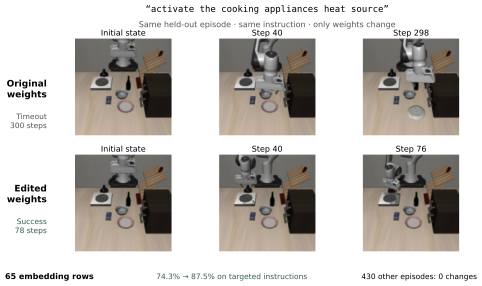

# 大语言模型能通过修改权重调试机器人吗？

[Jusheng Zhang](https://jushengzhang.github.io/)¹ · Keze Wang² · [Liang Lin](https://scholar.google.com/citations?user=Nav8m8gAAAAJ)²<br>
¹ Stanford University · ² X-Era AI

**[论文](https://arxiv.org/abs/2611.09376) · [首版下载](https://github.com/jushengzhang/robot-weight-debugging/releases/tag/v0.1.0) · [实验记录](transcripts) · [复现指南](docs/REPRODUCING.md) · [English](README.md)**

> **这是首个开源版本（v1），对应[论文第一版](https://arxiv.org/abs/2611.09376v1)。第二版研究和真机实验正在进行。** 当前发布的结果来自仿真。[版本与研究进展 →](docs/PROJECT_STATUS.md)

GPT-6 Astra 读取预训练机器人策略的权重，结合有限次数的模拟器反馈，只修改 **65 行词嵌入**，就修复了一类指令理解失败。编辑过程**不做梯度更新，也不使用新的示范数据**。



*同一条指令、同一个场景、相同随机种子和初始状态索引。左边是原始 π₀.₅，右边是修改后的策略。*

> 原始指令：“position the glass container of fermented grapes atop the storage unit for dishes and utensils”<br>
> 意思是：把装着葡萄酒的玻璃容器放到收纳碗碟和餐具的柜子顶上。

原始策略执行 **300 步后超时**，修改后在 **85 步成功**。这是从预留评测中选出的一个修复案例，不能用来估计总体成功率；右侧成功后停留在终止帧，左侧继续播放。[修改前视频](assets/libero_goal_v1174_s7_i0_orig_fail.mp4) · [修改后视频](assets/libero_goal_v1174_s7_i0_edit_succ.mp4) · [回合与制作记录](assets/README.md)

## 修改带来了什么？

在 **765 条预留的 LIBERO-Plus 改写指令**上，三次独立编辑中效果最好的一次，将 π₀.₅ 的成功率从 **86.3% 提高到 92.0%**：修好 48 个回合，同时使 4 个原本成功的回合失败。精确配对检验 *p* = 1.31 × 10⁻¹⁰。

| 实验 C 的作用范围 | 修改前 | 修改后 |
| --- | ---: | ---: |
| 含有被改 token 的指令 · 335 个回合 | **74.3%** | **87.5%** |
| 不含被改 token 的指令 · 430 个回合 | 成功 411 个 | 成功 411 个 |

其余 430 个回合的**成败结果没有一个发生变化**。这里说的是成败，不是整条轨迹逐值相同。三次语言编辑在同一组预留样本上都取得了显著提升。[完整结果、对照实验与适用范围 →](docs/RESULTS.md)

<details>
<summary>展开查看论文中的结果总览</summary>



</details>

## 按问题看实验

本仓库提供实验代码、**全部 16 次编辑的对话记录**、实际执行的工具代码及输出、实验笔记、逐回合评测记录，以及实际评测过的稀疏修改。每次实验都有单独的 README，可以直接找到笔记、最后答复和工具日志。

| 我们问了什么？ | 策略 | 实验与记录 |
| --- | --- | --- |
| 能否用少量权重修改，修复陌生说法带来的失败？ | π₀.₅ | [A](transcripts/pi_lang_a) · [B](transcripts/pi_lang_b) · [C](transcripts/pi_lang_c)：三次均有提升；[可应用的修改](edits/pi05-language-c) |
| 能否修复无关指令后缀造成的干扰？ | FastWAM | [首次搜索](transcripts/fw_suffix) · [跟进 A](transcripts/fw_suffix2_a) · [B](transcripts/fw_suffix2_b) · [C](transcripts/fw_suffix2_c)：跟进实验没有显著的修复收益 |
| 能否修复视觉或语言扰动下的失败？ | FastWAM | [相机](transcripts/fw_camera) · [背景](transcripts/fw_background) · [语言](transcripts/fw_language) |
| 能否让机器人从失败状态中恢复？ | π₀.₅ | [A](transcripts/rec_a) · [B](transcripts/rec_b) · [C](transcripts/rec_c)：没有保留修复 |
| 能否提高更广泛的鲁棒性？ | π₀.₅ | [A](transcripts/pro_a) · [B](transcripts/pro_b) · [C](transcripts/pro_c)：候选均被放弃，目标类别的收益仍不确定 |

**失败的搜索也值得看。** 论文分别记录了内部信号、磁盘上留下的候选，以及编辑器最终决定保留的修改。部分历史实验的收尾操作没有执行，因此不能仅凭“文件还在”判断它保留了修改。[实验日志怎么看 →](transcripts/README.md)

## 从这里开始

**不用 GPU，先核对论文数字。** 下面的脚本只依赖 Python 标准库，从已发布的逐回合记录重新计算结果：

```bash
git clone https://github.com/jushengzhang/robot-weight-debugging.git
cd robot-weight-debugging
python3 evidence/audit_new_results.py
```

| 你想做什么？ | 看这里 |
| --- | --- |
| 查看或应用实际评测过的 65 行修改 | [权重、配方与应用脚本](edits/pi05-language-c) |
| 核对正文和补充材料中的数字 | [评测证据说明](evidence/README.md) |
| 完整跟一次编辑过程 | [语言实验 C](transcripts/pi_lang_c) |
| 运行仿真后端或开展新的编辑实验 | [复现指南](docs/REPRODUCING.md) · [实验源码](experiments) |
| 下载已发表版本的 PDF 和 LaTeX | [论文材料](paper) · [首版下载](https://github.com/jushengzhang/robot-weight-debugging/releases/tag/v0.1.0) |

完整模型和模拟器资源需从上游项目获取。复现指南说明了环境依赖和路径配置；首版保留了研究所用的历史代码，尚未打包成一键安装的仿真容器。

## 与 Weight-Space Programming 的关系

本研究延续 [*Sparks of Weight-Space Programming*](https://rikiyat.github.io/blog/weight-space-programming/) 及其[公开实验日志](https://github.com/RikiyaT/lm_understand-logs)提出的问题，把编辑对象推进到预训练机器人策略，并通过配对仿真回合检验结果。目前得到支持的是**精确的词汇修复**；没有成功的搜索则帮助我们看清它的边界。

## 引用与许可

引用格式见[英文首页](README.md#citation)。作者原创代码采用 [Apache-2.0](LICENSE)；基座模型、派生权重、数据和论文沿用各自适用条款，见[第三方说明](THIRD_PARTY_NOTICES.md)。
